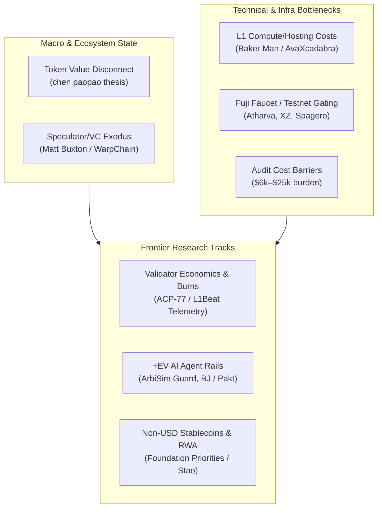

# Empirical Field Report: Avalanche Builders Community Intelligence & Qualitative Audit

**Date of Telemetry:** November 2026  
**Data Sources:**
- Telegram: *Avalanche Builders 🛠🔺* (`-1001365896273`)
- Telegram: *Avalanche Grantees 🔺* (`-1002453822530`)
- Telegram: *Avalanche Builders Hub* (`-1001871806091`)
- Discord: *Avalanche Team1* (`1313676030463967336` - `#builder-grants`, `#general-chat`)

---

## Executive Summary

An unvarnished, empirical examination of the internal Avalanche builder and grantee channels reveals an ecosystem in the midst of a structural transition. While top-down institutional messaging highlights *Avalanche9000*, sovereign L1s, and RWA adoption, on-the-ground builders are navigating severe macro headwinds, technical friction, and economic debates.

The primary signals decompose into five structural themes:
1. **The Value Accrual Dilemma:** Growing discontent and open debate regarding the disconnect between institutional network growth and $AVAX token value capture.
2. **Avalanche9000 & L1 Operating Reality:** Enthusiasm for sovereign L1s (ACP-77) tempered by skyrocketing validator compute/server overhead and telemetry tooling gaps.
3. **The AI Agent Paradigm Shift:** Emergence of a thesis that "vibe-based crypto speculation is dead," replaced by the need for deterministic, +EV agent transaction rails, pre-flight simulation, and execution environments.
4. **DevEx Friction & Infrastructure Gates:** Persistent basic developer experience hurdles, ranging from broken/gated Fuji testnet faucets to multi-month grant review latencies and prohibitive audit costs.
5. **Community Exhaustion vs. Core Builders:** High noise-to-signal ratios on public channels (VC deal scouts, marketing agencies, scammers) causing core builders to retreat into private signal groups and direct execution.

---

## 1. The Value Accrual Dilemma & Staking Tokenomics

A central philosophical and financial tension in the developer chat centers on whether the growth of sovereign L1s (formerly Subnets) accrues real economic value to the base $AVAX asset.

### Verbatim Community Signal
> **chen paopao (Builders Chat):**  
> *"Avalanche has outstanding technology, fast finality, and a rapidly growing ecosystem in RWA, stablecoins, and institutional adoption. However, the market’s biggest concern today is not whether Avalanche is successful—it is whether the value created by the network ultimately accrues to AVAX holders.*  
> *Today, there is a visible disconnect between network growth and token performance...*  
> *1. Requiring enterprise L1s to lock AVAX for long-term network participation.*  
> *2. Allowing governance to optimize the fee model over time instead of maintaining permanently minimal fees.*  
> *3. Using a portion of protocol revenue generated by RWA, stablecoins, and enterprise applications to support AVAX through buybacks, burns, or staking rewards.*  
> *4. Transitioning staking rewards toward real network revenue instead of relying primarily on token emissions.*  
> *Network Growth → AVAX Demand → AVAX Holder Value."*

### Foundation Alignment
This grassroots push matches the agenda communicated directly by Avalanche Foundation leadership during the February grantee briefing:
> **Memo | Avalanche (Grantees Chat):**  
> *"Joined by Matias A., Chief Investment Officer, and Eric Lu, Lead Economist, who will share their key priorities and focus areas for Avalanche in 2026:*  
> *• Tokenomics & Validator incentives*  
> *• Expanding ecosystem GDP*  
> *• Improving DEX volume rankings*  
> *• Growing RWA and non-USD stablecoin TVL."*

### Research Implications
This debate directly validates the research scope of the **Helicon Native Engine**, **ACP-49**, and **ACP-77**. The ecosystem is actively searching for mechanisms that transition staking yields from inflationary emissions to real programmatic burns and fee-accrual dynamics without pricing out modular L1 validators.

---

## 2. Avalanche9000, L1 Economics & Infrastructure Realities

The release and deployment of ACP-77 (Avalanche9000) transformed Subnets into sovereign L1s with dynamic validator registration and continuous AVAX burn fees. However, builders are encountering tangible operational challenges.

### Validator Burn Telemetry & Tracking
- **L1Beat Launch (`@selim5335`):** Tracking empirical L1 validation fees and AVAX burns:
  - 13,189+ AVAX burned to date across active sovereign L1s.
  - Granular tracking for per-chain AVAX burns, validator deposit histories, balance breakdowns, and "days of runway remaining."
- **Validator Infrastructure Costs:**  
  While ACP-77 eliminated the mandatory 2,000 AVAX staking barrier on the P-Chain, the hardware and compute cost of running dedicated validator nodes remains high:
  > **Baker Man ∀ (`@BakerMan4` - AvaXcadabra):**  
  > *"If you are currently running L1 nodes, you’ve probably noticed that compute and server costs just keep skyrocketing... It’s starting to take a massive bite out of everyone's budget."*  
  > (Offering subsidized <$60/mo hosting contracts to keep indie L1s alive).

### Non-EVM L1s & Privacy Exploration
- **Non-EVM Signal Group (`@mrkit2u` - red·bridge):** Core builders are building non-EVM execution layers on Avalanche, including running a Zcash VM inside an Avalanche L1, integrating eERC20 privacy rails, and bridging outwards via Chainlink CCIP.
- **Gaming L1s (`@angeiv404`):** Deploying three separate L1 sub-networks for Unreal Engine 5 integrations (permissioned, public, testnet) to achieve ultra-high single-transaction gas limits and custom execution logic.

---

## 3. The AI Agent Shift: From Speculation to +EV Computational Rails

A distinct cluster of senior builders in the Grantees channel has formulated a sharp thesis on the divergence between legacy Web3 speculation and the emergent agent economy.

### Key Discourse
> **BJ | Pakt (`@azzabazazz`):**  
> *"The common refrain I hear from the tech side is that AI means the era of crypto is over. Agents run on +EV expected utility, period. No politicking, no backroom deals, or vibey memetics. Thankfully the Avalanche builder community has always distinguished itself as real builders building real tech. Now is our time to show that building on Avalanche is the most +EV choice a builder can make because transacting on Avalanche is the most +EV choice an agent can make."*

> **Rahul Pandey (`@rahulpandey187` - ArbiSim Guard):**  
> *"AI agents doing on-chain transactions are flying blind right now. They just execute and hope for the best. ArbiSim intercepts that transaction before it hits the chain, runs it through a live fork, and tells the agent exactly what will happen — reverts, slippage, gas, MEV risk — before any real money moves. Deployed and verified on Avalanche Fuji."*

> **Jomari (`@Jomarip`):**  
> Articulated a forward-deployment lifecycle for decentralized infrastructure and autonomous systems:
> $$\text{Reality} \longrightarrow \text{Discovery} \longrightarrow \text{Architecture} \longrightarrow \text{Build} \longrightarrow \text{Production} \longrightarrow \text{Evidence} \longrightarrow \text{Reuse}$$  
> Arguing that autonomous agent deployments must yield reusable operational controls, evals, and system signals rather than one-off hacks.

---

## 4. Ground-Level Friction: DevEx, Faucets, Audits & Grants

The day-to-day developer experience on Avalanche exhibits several persistent bottlenecks that hinder early-stage teams:

### 1. The Fuji Testnet Faucet Barrier
Multiple builders across October and November 2026 were blocked from deploying test contracts or MVPs because the official web faucet is aggressively rate-limited, requires social verification, or fails:
- `Atharva`: *"i need some test AVAX on Fuji C Chain for a project, its token extensive so can anyone who has test avax fund this wallet..."*
- `XZ`: *"Hi, I need 0.1 test AVAX on Fuji C-Chain to deploy a test USDT contract. I cannot use the wallet-connected faucet. Could you help fund this address?"*
- `Spagero.Eth`: *"Gm everyone, someone should help with fuji testnet 0xeE86870..."*
*Signal:* Basic onboarding infrastructure for solo developers is actively gated, forcing devs to resort to peer-to-peer begging in chat.

### 2. Grant Review Latency & Milestone Sync
Grantees in both Discord (`#builder-grants`) and Telegram report substantial turnaround times:
- `anka1623` (Discord): *"It's almost been 3 months... There have been some updates on my project. How should I inform the review team..."*
- `Jomari` / `Daniel🔺`: Grantees inquiring about research grant selection rounds note that screening committees have large proposal backlogs.
- `Tevin smith`: Reporting that milestones submitted through the *Retro9000* builder portal fail to render on live project profiles.

### 3. Prohibitive Smart Contract Audit Costs
Audit intermediaries (such as Areta Market and Procur3) are heavily marketing checklists and aggregation platforms because seed-stage builders cannot afford standard $15,000–$40,000 audit retainers before testnet/mainnet launches.

---

## 5. Ecosystem Macro Sentiment & Network Dynamics

A candid assessment from founders highlights the weariness of the current cycle:

> **Matt Buxton (Founder WarpChain - Grantees Chat):**  
> *"There's a fair few projects in here that are dead or actively trying to court other chains that don't want to make noise. Not just on avax but its rough in general atm. Alts are down, EVM chains basically down only, every positive message on TG is a scam. Only 4 years ago you could genuinely use TG and groups, now the VCs and investors, speculators don't exist here. Its just founders, farmers, BD's and scammers. I genuinely thought many times we could do a lot with a strong builder community, but without chain support we'd end up endorsing projects that are DOA. Now with AI removing the barriers around dev everyone left alive is so locked in building it's genuinely hard to have the time to interact.. this wasn't meant to be mean, I really hope it improves."*

This is complemented by observations from `@chokosabe` (Ekko) regarding low social reciprocity: builders broadcast their own launches and requests for feedback, but rarely engage with or test peer products due to time scarcity and security caution.

---

## 6. Synthesis: High-Leverage Research Opportunities

For your research programs, these empirical community pain points highlight specific high-value opportunities:

| Domain | Observed Community Pain Point | Strategic Research / Engineering Solution |
| :--- | :--- | :--- |
| **Validator Economics (Helicon)** | Burning vs. inflation tension; concern that L1s don't accrue value to AVAX holders (`chen paopao`). | Formally model ACP-77 continuous burn equilibria vs. validator churn thresholds; prove long-term net deflationary dynamics under sovereign L1 expansion. |
| **Native Stablecoins (AvUSD)** | Foundation prioritizes non-USD stablecoin TVL and RWA; startups like *Stao* struggle with credit scoring and default risk underwriting. | Deliver mathematically proven liquidation/collateral waterfalls and cadCAD digital twin risk modeling for native decentralized credit instruments. |
| **Agent Rails (Predge / SolARM)** | AI agents executing blind on EVM chains, risking MEV and reverts (`ArbiSim Guard`, `BJ / Pakt`). | Develop formal intent-binding, pre-flight simulation guarantees, and autonomous agent escrow rails natively tuned for sub-second Avalanche finality. |
| **DevEx & Tooling** | Fuji faucet friction and lack of lightweight node deployment infrastructure. | Open-source minimal faucet bots or local simulation harnesses (e.g. lightweight local test environments) to capture developer mindshare. |
